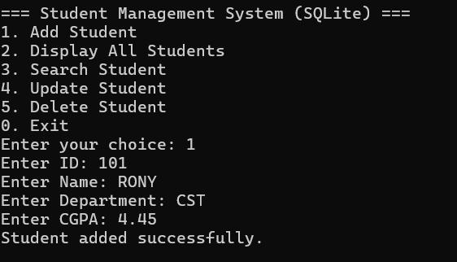

# Student Management System

A console-based Student Management System written in C++. It lets you manage student records with full CRUD operations and saves data permanently in a text file.

## Features

- Add a new student (ID, name, department, CGPA)
- Display all students
- Search a student by ID
- Update student information
- Delete a student
- Duplicate ID check
- Data saved automatically to a file

## Technologies Used

- C++ (STL: vector, fstream, string)
- File handling for data storage

## How to Run

1. Clone the repository:
   `git clone https://github.com/Rony60031/student-management-system.git`
2. Go to the project folder:
   `cd student-management-system`
3. Compile:
   `g++ main.cpp -o student_system`
4. Run:
   `./student_system`

## Future Improvements

- Migrate storage from text file to an SQL database
- Add a GUI
- Add login system for admin

## Author

Rony - https://github.com/Rony60031
